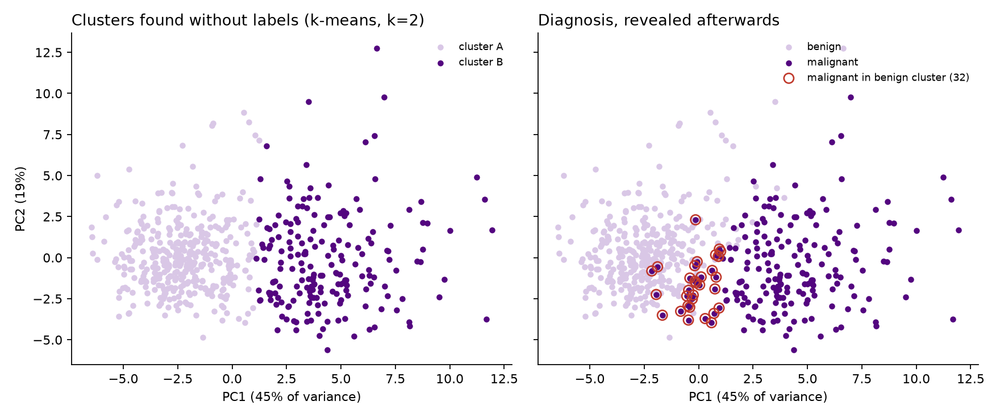
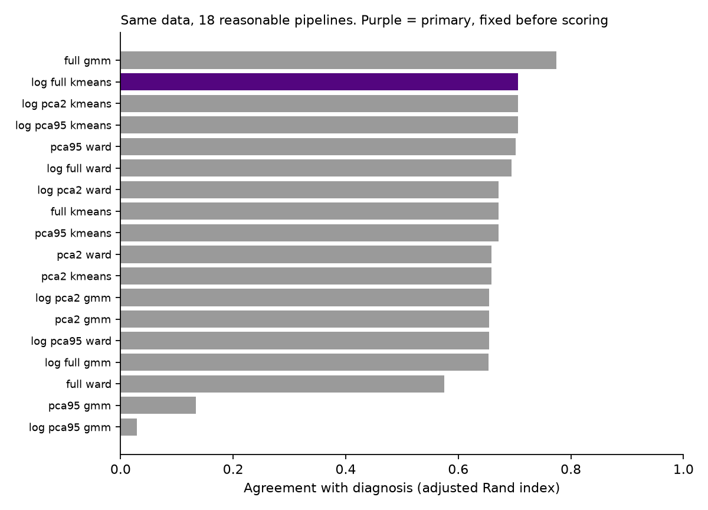

# Do breast tumours sort themselves? Unsupervised analysis of WDBC cytology

The question: can 569 breast fine-needle aspirates, each described by 30 nuclear measurements,
be separated into benign and malignant **without ever being told which is which**? And when the
separation fails, which tumours does it miss?

Data: the [Wisconsin Diagnostic Breast Cancer](https://archive.ics.uci.edu/dataset/17/breast+cancer+wisconsin+diagnostic)
dataset (Wolberg, Mangasarian, Street et al., 1993; [doi:10.24432/C5DW2B](https://doi.org/10.24432/C5DW2B)). It has 212 malignant and 357 benign cases, and
ships with scikit-learn.



## Result

| | Value |
|---|---|
| Clusters chosen without labels (silhouette, k = 2..8) | **k = 2** (0.34, next best 0.30) |
| Agreement with diagnosis, adjusted Rand index | **0.71** |
| Accuracy once clusters are named | **92.1%** |
| Malignant tumours caught (sensitivity) | **84.9%**. 32 of 212 land in the benign cluster |
| Benign tumours correctly grouped (specificity) | 96.4% |
| Stability across 100 seeds / 200 bootstrap resamples | identical split / median ARI 0.97 |
| Supervised reference, logistic regression, 10-fold CV | 97.9% accuracy, 95.8% sensitivity |

The structure is real. Without labels, the data splits in two, and the two groups line up with
the diagnosis 92% of the time. The split is also stable across random seeds and bootstrap
resamples.

**It still misses one cancer in seven.** A label-free grouping is a description of the data, not
a screening tool. A supervised model with the same features catches 96% of cancers.

### Which cancers it misses

The 32 missed malignancies sit between the two groups. Their nuclei are smaller and less concave
than the malignancies it catches, but their texture is already malignant-like:

| Median | Benign | Malignant, missed | Malignant, caught |
|---|---|---|---|
| mean radius | 12.2 | 14.8 | 18.0 |
| mean concave points | 0.023 | 0.046 | 0.089 |
| worst area | 547 | 892 | 1431 |
| mean texture | 17.4 | **21.5** | **21.5** |

Clustering splits the data along the dominant axis of variation. That axis is PC1, where 45% of
the variance is driven by concavity, concave points, compactness and perimeter. Mean texture
ranks only 25th of 30 on PC1. So the cancers that clustering misses are the small, smooth-edged ones, the
cases where size and shape have not yet diverged. Unsupervised structure follows the biggest
variance, not the clinically important one.

## Method

1. `log1p`, then a z-score on all 30 features. Area and perimeter are strongly right-skewed.
2. **PCA**, the method from the 2023 course. 10 components explain 95% of the variance, and PC1
   alone explains 45%.
3. **Choosing k without labels:** silhouette over k = 2..8. k = 2 wins.
4. **Primary analysis:** k-means with k = 2 on the full standardised log space, 20 initialisations.
5. **Only then** is the diagnosis revealed. Each cluster is named after its majority class, then
   scored.
6. **Sensitivity analysis:** every combination of {raw, log} × {all features, 2 PCs, 95% PCs} ×
   {k-means, Ward, Gaussian mixture}, giving 18 pipelines, all reported.



**The pipeline choice matters more than the algorithm.** Across 18 reasonable pipelines, the
agreement with diagnosis ranges from ARI 0.03 to 0.77. A Gaussian mixture on the 95% PCA space
collapses almost entirely. One pipeline, a mixture model on raw features, scores higher than the
primary one.

Picking the best-scoring pipeline after seeing the labels would be circular. The labels would
have chosen the method. So the primary analysis is fixed on label-free grounds: the course
method, a log transform for the skew, and k from the silhouette. Everything else is shown, not
hidden.

In fairness: I had looked at an exploratory version of this table before fixing the primary
choice. That is why all 18 results are published.

## Run it

```bash
pip install -r requirements.txt
python -m wdbc.analysis     # about 30 s, writes results/results.json and figures/
python -m pytest -q
```

The tests check four things: the dataset shape, that clustering output does not depend on the
labels, the cluster-to-diagnosis mapping and error counts, and that the headline result
reproduces.

## From the 2023 course to this

In 2023 our four-person team ran PCA (in MATLAB) and k-means / hierarchical clustering (in
Python) on the Iris flower dataset for *Advanced Analysis of Medical Data*. The original script
is kept in [`original_2023/`](original_2023/). This repository applies the same methods to
medical data and adds the parts the exercise lacked: a question, label-free model selection,
quantified agreement, stability and a sensitivity analysis.

## Limitations

- A single public dataset from one institution (Wisconsin, early 1990s). The features were
  extracted from digitised images by the original authors' software.
- The diagnosis comes from the original dataset and is treated as ground truth.
- This is an analysis exercise, not a diagnostic or screening tool.

## Credit

2023 team: Jeremia Kerstner, Manuel Kalus, Robert Aigner and Samuel Henry Mba (FH Technikum
Wien). The 2026 analysis on WDBC is mine.

Data: W. Wolberg, O. Mangasarian, N. Street, W. Street. *Breast Cancer Wisconsin (Diagnostic)*.
UCI Machine Learning Repository, 1993. doi:10.24432/C5DW2B. Licensed CC BY 4.0.
